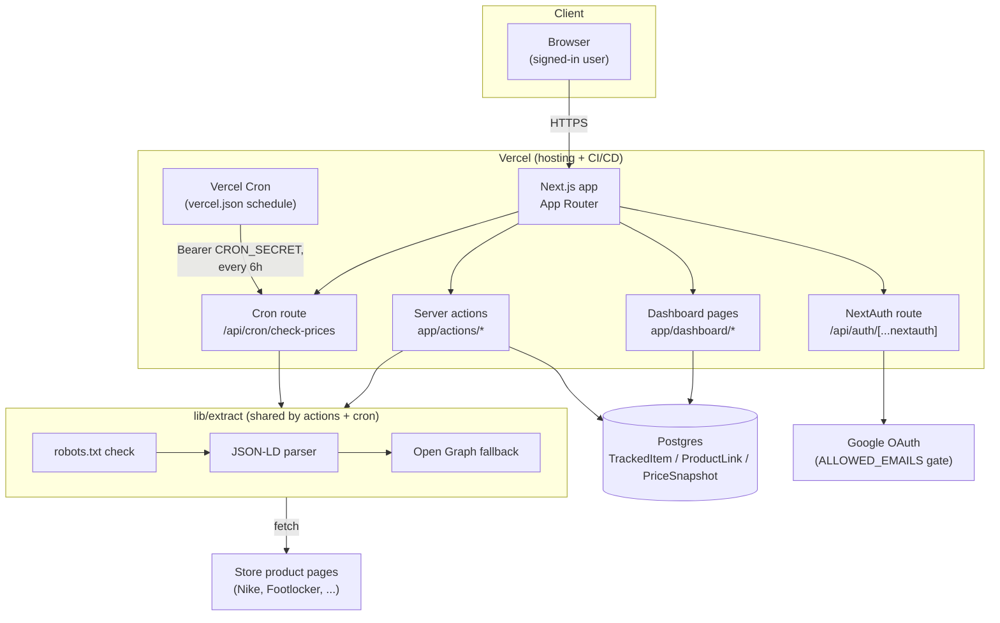

# Price Watch

Track the price of things you want to buy — across every store that sells
them — and get a dashboard of price history so you know when to pull the
trigger.

Flow: paste a product link → it's auto-detected (title, image, price) →
add more links for the same product from other stores → a scheduled job
rechecks all of them periodically → see price history and the current
cheapest offer on one page.

## Architecture



- **Vercel hosts the app and is the only CI/CD** — every push to `main`
  triggers a build; every PR gets its own preview deployment. There is no
  separate GitHub Actions workflow (see "Hosting & CI/CD" below).
- **Server actions and the cron route share `lib/extract`** — the same
  fallback-chain extractor backs both "add a link" (interactive) and
  "recheck all links" (scheduled), so there's one code path to trust.
- **Postgres is the only state** — no queue, no cache layer; `PriceSnapshot`
  rows are append-only, which is what makes the history chart and
  "lowest ever" computation possible.

## Why this works across almost any store, without a scraper per site

Most e-commerce sites publish the same two pieces of standard metadata for
SEO, regardless of platform (Shopify, WooCommerce, a big retailer's own
stack, ...):

1. **schema.org `Product` JSON-LD** — a `<script type="application/ld+json">`
   block with `name`, `image`, and `offers.price`/`priceCurrency`.
2. **Open Graph / product meta tags** — `og:title`, `og:image`,
   `product:price:amount`, `product:price:currency`.

`lib/extract/` tries JSON-LD first, then falls back to Open Graph. This is
far more stable than reverse-engineering each store's internal API or HTML
structure (which is what a site-specific scraper — see the `nike-basketball-scraper`
project — has to do, and why that approach breaks whenever a site redesigns).
It won't work on every site (some render everything client-side with no
metadata at all), but it covers the large majority without per-site code.

## ⚠️ One thing I could not verify from this sandbox

This was built in an environment whose network policy only allows outbound
HTTPS to a short allowlist (npm, PyPI, crates.io, the Go proxy, Anthropic's
API) — **everything else, including any real store's website, is blocked**.
So while `lib/extract/` is fully unit-tested against realistic fixture HTML
(see `__tests__/lib/extract/`), I have not been able to run it against a
real, live product page end-to-end. Before relying on this:

1. Set up the `.env` values below and `pnpm db:push`.
2. Run `pnpm dev`, sign in, and paste a real product URL (try something
   simple/well-known first, e.g. a Shopify store or a big retailer).
3. Check the item's detail page: did title/image/price come through? If a
   particular store doesn't work, open its page source and check whether
   it has JSON-LD `Product` data or Open Graph meta tags at all — if not,
   that store would need a dedicated extractor added to `lib/extract/`.

## Stack

Next.js (App Router) + Prisma + Postgres + NextAuth (Google) + Tailwind —
same pattern as other dashboards I've built, trimmed down: no
multi-tenant/organization model, since this is a single-user (or small
household) tool. Access is gated by an email allowlist (`ALLOWED_EMAILS`)
rather than a membership table.

## Setup

```bash
cp .env.example .env.local   # fill in the values below
pnpm install
pnpm db:push                 # creates the three tables
pnpm dev
```

### Environment variables

| Variable | Notes |
| --- | --- |
| `DATABASE_URL` / `DATABASE_URL_UNPOOLED` | Postgres (Vercel Postgres, Neon, Supabase, ...) |
| `NEXTAUTH_URL`, `NEXTAUTH_SECRET` | Standard NextAuth config |
| `GOOGLE_CLIENT_ID`, `GOOGLE_CLIENT_SECRET` | You can reuse an existing Google Cloud OAuth client from another project — just add this app's redirect URI (`/api/auth/callback/google`) to its authorized redirect URIs |
| `ALLOWED_EMAILS` | Comma-separated. **Required** — sign-in is refused for everyone if this is empty |
| `CRON_SECRET` | Random secret; set the same value as a Vercel environment variable so Vercel Cron's request is authorized |

### Scheduled price checks

`vercel.json` defines a cron hitting `/api/cron/check-prices` every 6 hours.
Vercel sends `Authorization: Bearer <CRON_SECRET>` automatically when that
env var is set on the project — see [Vercel Cron Jobs docs](https://vercel.com/docs/cron-jobs).
Running elsewhere (not Vercel)? Call that same endpoint with that header
from whatever scheduler you use (cron, GitHub Actions, etc.).

> ⚠️ **Vercel's Hobby (free) plan only runs cron jobs once a day**, and only
> at the start of an hour. The `0 */6 * * *` schedule above needs a Pro plan
> (or higher) to actually fire every 6 hours — on Hobby, Vercel silently
> collapses it to one run/day. If you're staying on Hobby, change the
> schedule to e.g. `0 8 * * *` (once daily at 08:00 UTC) so what's
> configured matches what actually runs.

## Hosting & CI/CD (Vercel)

This project is meant to live entirely on Vercel — hosting *and* CI/CD,
same as the pattern in my other dashboards:

1. **Connect the repo**: Vercel → Add New Project → import
   `liranmeir/price-watch`. Framework preset "Next.js" is auto-detected.
2. **Database**: add Postgres via the Vercel Storage/Marketplace tab
   (Vercel Postgres, or a Neon/Supabase integration) — it sets
   `DATABASE_URL`/`DATABASE_URL_UNPOOLED` for you. Using something else?
   Add those two yourself in Project Settings → Environment Variables.
3. **Environment variables**: set everything in `.env.example` (`NEXTAUTH_URL`
   → your production URL, `NEXTAUTH_SECRET`, `GOOGLE_CLIENT_ID`/`SECRET`,
   `ALLOWED_EMAILS`, `CRON_SECRET`) in Project Settings → Environment
   Variables. Add production's domain's `/api/auth/callback/google` to the
   Google OAuth client's authorized redirect URIs.
4. **Deploys = CI**: Vercel runs `pnpm build` on every push, which is
   `prisma generate && pnpm run verify && next build` — `verify` is the
   full Vitest suite. **A failing test fails the build and blocks the
   deploy.** There's no separate GitHub Actions workflow; the Vercel build
   is the only CI, so don't rely on anything outside `pnpm build` to catch
   regressions.
5. **Branches**: push to `main` → production deploy. Any other branch or
   PR → its own preview deployment with a unique URL (useful for checking
   a change before it reaches production), sharing the same env vars
   unless you override them per-environment in Project Settings.
6. **Cron**: once the project is on Vercel, the job in `vercel.json` shows
   up automatically under the project's "Cron Jobs" tab — no extra setup
   beyond `CRON_SECRET` above. See the Hobby-plan note just above.

## Data model

```
TrackedItem (name, note, targetPrice, archived)
  └─< ProductLink (url, storeName, lastCheckedAt, lastStatus, lastError)
        └─< PriceSnapshot (price, currency, title, imageUrl, inStock, fetchedAt)
```

One `TrackedItem` = one thing you want (e.g. "Dyson V10 Absolute"). It can
have several `ProductLink`s (the same thing listed on different stores).
Each check appends a `PriceSnapshot` rather than overwriting — that's what
lets the dashboard chart price history and find the all-time low.

## Project layout

- `lib/extract/` — the generic product-page extractor (JSON-LD → Open
  Graph fallback chain), a small robots.txt politeness checker, and a
  fetch wrapper with timeout/retry.
- `lib/pricing.ts`, `lib/chart-data.ts`, `lib/currency.ts` — pure,
  well-tested helpers for "cheapest current offer", "lowest ever", and
  building the multi-line chart dataset.
- `app/actions/` — server actions for CRUD on items/links (create, add
  link, recheck, archive, delete). Follows `{ success, data?, error? }`.
- `app/api/cron/check-prices/` — the scheduled re-check job.
- `app/dashboard/` — item list + per-item detail page (chart, links,
  add-link form).

## Being a good citizen

- `lib/extract` checks `robots.txt` before fetching any page, and fails
  closed (treats it as disallowed) if robots.txt can't be read at all.
- The cron job waits between requests instead of firing them all at once.
- This is for personal use. Don't crank up check frequency or add dozens
  of links per item — be mindful of the stores you're pulling from.

## Testing

```bash
pnpm test            # vitest, watch mode
pnpm test run        # single run
pnpm test:coverage
pnpm exec tsc --noEmit -p tsconfig.json
```

All tests run offline (fixture HTML / mocked `fetch` / mocked Prisma) — no
network access needed or used.
