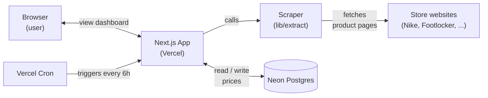
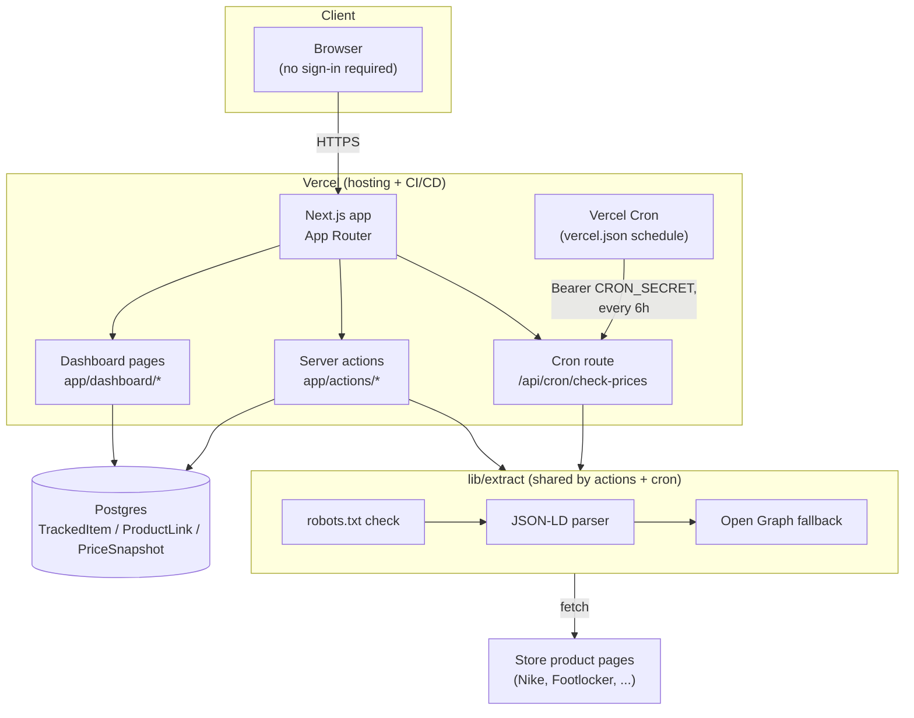
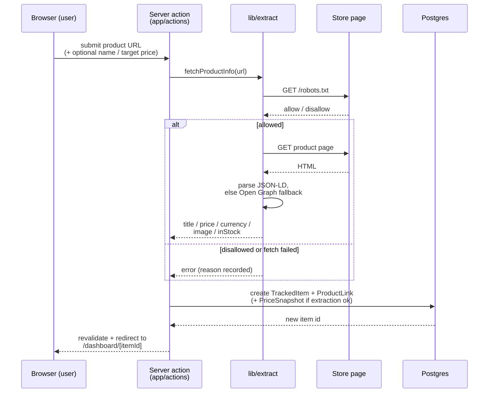
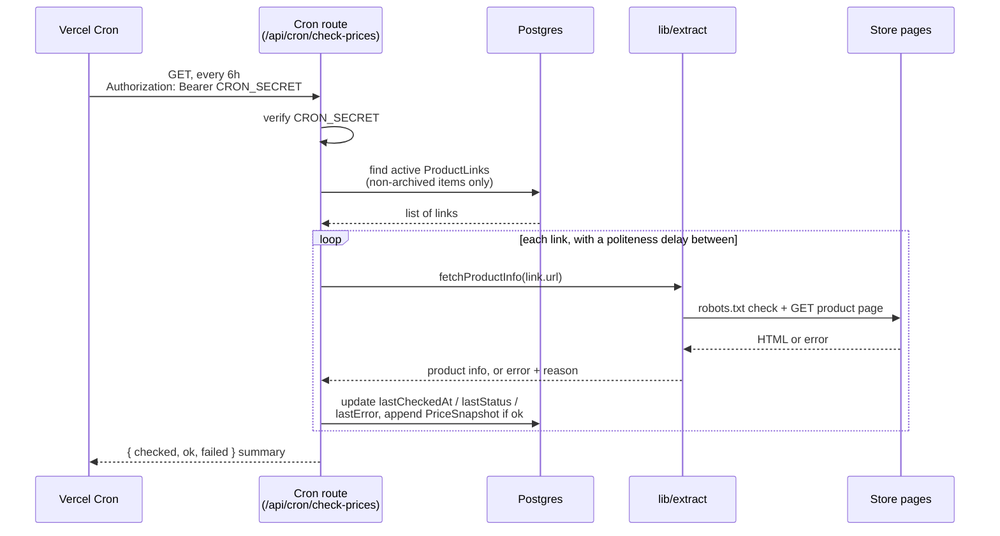

# Price Watch

Track the price of things you want to buy — across every store that sells
them — and get a dashboard of price history so you know when to pull the
trigger.

Flow: paste a product link → it's auto-detected (title, image, price) →
add more links for the same product from other stores → a scheduled job
rechecks all of them periodically → see price history and the current
cheapest offer on one page.

## ⚠️ No auth right now

There is currently **no sign-in and no access control** — anyone with the
URL can view and add/edit/delete everything. This was removed deliberately
to get a first deploy working quickly without needing Google OAuth
credentials set up. Before treating this as more than a personal/throwaway
deployment:

- At minimum, turn on **Vercel's own Deployment Protection** (Project
  Settings → Deployment Protection) so only your team can reach it, at
  least until/unless you attach a custom domain (Vercel's protection
  exempts custom domains by default).
- To bring back real per-user sign-in, NextAuth + a Google-account
  allowlist is the straightforward option — it's how this app worked
  before; see git history (`lib/auth.ts`, `middleware.ts`,
  `app/login/`, `app/api/auth/`) for the previous implementation to
  restore or adapt.

## Architecture


Logos: [Next.js](https://nextjs.org), [Vercel](https://vercel.com),
[Neon](https://neon.tech) and [Nike](https://nike.com) (as the store
example) — used here only to label which product each box is, not an
endorsement by or affiliation with any of them. Generated by
`docs/gen-architecture-logos.js` using the
[simple-icons](https://www.npmjs.com/package/simple-icons) package (see
that script's header comment for how to re-run it after editing).

<details>
<summary>Plain text-only version + a more detailed component diagram (click to expand)</summary>




Mermaid source for both, to edit and re-render
(`npx @mermaid-js/mermaid-cli -i docs/<file>.mmd -o docs/<file>.svg`):

`docs/architecture-simple.mmd`:



`docs/architecture.mmd` (the detailed one):



</details>

- **Vercel hosts the app and is the only CI/CD** — every push to `main`
  triggers a build; every PR gets its own preview deployment. There is no
  separate GitHub Actions workflow (see "Hosting & CI/CD" below).
- **Server actions and the cron route share `lib/extract`** — the same
  fallback-chain extractor backs both "add a link" (interactive) and
  "recheck all links" (scheduled), so there's one code path to trust.
- **Postgres is the only state** — no queue, no cache layer; `PriceSnapshot`
  rows are append-only, which is what makes the history chart and
  "lowest ever" computation possible.

## Data flow

The diagram above is the static map of components; these two sequences
are how data actually moves through them over time.

**Adding an item / a link** (interactive, triggered from the browser):


**Scheduled recheck** (no browser involved — Vercel Cron drives it):


<details>
<summary>Mermaid source for both sequence diagrams</summary>

`docs/dataflow-add-link.mmd`:



`docs/dataflow-cron.mmd`:



Re-render either with mermaid-cli after editing, e.g.:
`npx @mermaid-js/mermaid-cli -i docs/dataflow-add-link.mmd -o docs/dataflow-add-link.svg`

</details>

- **Nothing is written until extraction finishes** — both flows call
  `lib/extract` first and only write to Postgres once they have a result
  (success or error), so a slow or failing store page never leaves a
  half-written row.
- **The cron route is intentionally "dumb"** — it does no retries or
  smarts of its own beyond what `lib/extract`'s own fetch wrapper already
  does; it just loops, waits between links, and records whatever comes
  back. All the actual parsing logic is shared with the interactive path.
- **`PriceSnapshot` is append-only in both flows** — a recheck never
  overwrites the previous reading, which is what lets the dashboard chart
  history and compute "lowest ever" across either flow's writes.

## Why this works across almost any store, without a scraper per site

Most e-commerce sites publish the same two pieces of standard metadata for
SEO, regardless of platform (Shopify, WooCommerce, a big retailer's own
stack, ...):

1. **schema.org `Product` JSON-LD** — a `<script type="application/ld+json">`
   block with `name`, `image`, and `offers.price`/`priceCurrency`.
2. **Open Graph / product meta tags** — `og:title`, `og:image`,
   `product:price:amount`, `product:price:currency`.

`lib/extract/` tries JSON-LD first, then falls back to Open Graph. This is
far more stable than reverse-engineering each store's internal API or HTML
structure (which is what a site-specific scraper — see the `nike-basketball-scraper`
project — has to do, and why that approach breaks whenever a site redesigns).
It won't work on every site (some render everything client-side with no
metadata at all), but it covers the large majority without per-site code.

## ⚠️ One thing I could not verify from this sandbox

This was built in an environment whose network policy only allows outbound
HTTPS to a short allowlist (npm, PyPI, crates.io, the Go proxy, Anthropic's
API) — **everything else, including any real store's website, is blocked**.
So while `lib/extract/` is fully unit-tested against realistic fixture HTML
(see `__tests__/lib/extract/`), I have not been able to run it against a
real, live product page end-to-end. Before relying on this:

1. Set up the `.env` values below and `pnpm db:push`.
2. Run `pnpm dev` and paste a real product URL (try something
   simple/well-known first, e.g. a Shopify store or a big retailer).
3. Check the item's detail page: did title/image/price come through? If a
   particular store doesn't work, open its page source and check whether
   it has JSON-LD `Product` data or Open Graph meta tags at all — if not,
   that store would need a dedicated extractor added to `lib/extract/`.

## Stack

Next.js (App Router) + Prisma + Postgres + Tailwind — same pattern as
other dashboards I've built, trimmed down: no multi-tenant/organization
model, since this is a single-user (or small household) tool, and (for
now — see "No auth right now" above) no sign-in layer either.

## Setup

```bash
cp .env.example .env.local   # fill in the values below
pnpm install
pnpm db:push                 # creates the three tables
pnpm dev
```

### Environment variables

| Variable | Notes |
| --- | --- |
| `DATABASE_URL` / `DATABASE_URL_UNPOOLED` | Postgres (Vercel Postgres, Neon, Supabase, ...) |
| `CRON_SECRET` | Random secret; set the same value as a Vercel environment variable so Vercel Cron's request is authorized |

### Scheduled price checks

`vercel.json` defines a cron hitting `/api/cron/check-prices` once a day
(`0 8 * * *`, 08:00 UTC). Vercel sends `Authorization: Bearer <CRON_SECRET>`
automatically when that env var is set on the project — see [Vercel Cron Jobs docs](https://vercel.com/docs/cron-jobs).
Running elsewhere (not Vercel)? Call that same endpoint with that header
from whatever scheduler you use (cron, GitHub Actions, etc.).

> ⚠️ **Vercel's Hobby (free) plan only allows daily cron jobs — and actually
> enforces it at deploy time**, not just by silently downgrading. A more
> frequent schedule (anything with `*/N` in the hour field) makes the
> deployment itself fail with `cron_jobs_limits_reached` until you either
> change the schedule to once a day or upgrade to Pro.

## Hosting & CI/CD (Vercel)

This project is meant to live entirely on Vercel — hosting *and* CI/CD,
same as the pattern in my other dashboards:

1. **Connect the repo**: Project → Settings → Git → Connect Git Repository
   → pick `liranmeir/price-watch` (installs/authorizes Vercel's GitHub App
   if that hasn't happened yet). Framework preset "Next.js" is auto-detected.
2. **Database**: already provisioned — a Neon Postgres project backs this
   app, with `DATABASE_URL`/`DATABASE_URL_UNPOOLED` set on the Vercel
   project. Using something else instead? Replace those two in Project
   Settings → Environment Variables.
3. **Environment variables**: `CRON_SECRET` is already set. Once you have
   a production domain, nothing else is required to run (see "No auth
   right now" above for the access-control gap this leaves open).
4. **Deploys = CI**: Vercel runs `pnpm build` on every push, which is
   `prisma generate && pnpm run verify && next build` — `verify` is the
   full Vitest suite. **A failing test fails the build and blocks the
   deploy.** There's no separate GitHub Actions workflow; the Vercel build
   is the only CI, so don't rely on anything outside `pnpm build` to catch
   regressions.
5. **Branches**: push to `main` → production deploy. Any other branch or
   PR → its own preview deployment with a unique URL (useful for checking
   a change before it reaches production), sharing the same env vars
   unless you override them per-environment in Project Settings.
6. **Cron**: once the project is on Vercel, the job in `vercel.json` shows
   up automatically under the project's "Cron Jobs" tab — no extra setup
   beyond `CRON_SECRET` above. See the Hobby-plan note just above.

## Data model

```
TrackedItem (name, note, targetPrice, archived)
  └─< ProductLink (url, storeName, lastCheckedAt, lastStatus, lastError)
        └─< PriceSnapshot (price, currency, title, imageUrl, inStock, fetchedAt)
```

One `TrackedItem` = one thing you want (e.g. "Dyson V10 Absolute"). It can
have several `ProductLink`s (the same thing listed on different stores).
Each check appends a `PriceSnapshot` rather than overwriting — that's what
lets the dashboard chart price history and find the all-time low.

## Project layout

- `lib/extract/` — the generic product-page extractor (JSON-LD → Open
  Graph fallback chain), a small robots.txt politeness checker, and a
  fetch wrapper with timeout/retry.
- `lib/pricing.ts`, `lib/chart-data.ts`, `lib/currency.ts` — pure,
  well-tested helpers for "cheapest current offer", "lowest ever", and
  building the multi-line chart dataset.
- `app/actions/` — server actions for CRUD on items/links (create, add
  link, recheck, archive, delete). Follows `{ success, data?, error? }`.
- `app/api/cron/check-prices/` — the scheduled re-check job.
- `app/dashboard/` — item list + per-item detail page (chart, links,
  add-link form).

## Being a good citizen

- `lib/extract` checks `robots.txt` before fetching any page, and fails
  closed (treats it as disallowed) if robots.txt can't be read at all.
- The cron job waits between requests instead of firing them all at once.
- This is for personal use. Don't crank up check frequency or add dozens
  of links per item — be mindful of the stores you're pulling from.

## Testing

```bash
pnpm test            # vitest, watch mode
pnpm test run        # single run
pnpm test:coverage
pnpm exec tsc --noEmit -p tsconfig.json
```

All tests run offline (fixture HTML / mocked `fetch` / mocked Prisma) — no
network access needed or used.
